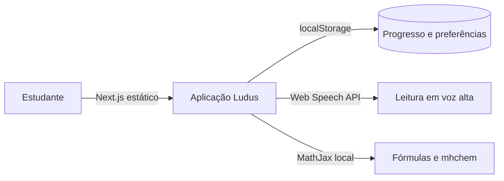

# Ludus

[](https://github.com/eemtijca/ludus/actions/workflows/qualidade.yml)
[](https://github.com/eemtijca/ludus/actions/workflows/testes.yml)
[](LICENSE)


Aplicação web de jogos educacionais de investigação para o ensino médio, organizada por áreas do conhecimento da BNCC. O projeto é um recurso de apoio ao Atendimento Educacional Especializado (AEE) e segue os princípios do Desenho Universal para a Aprendizagem (DUA): atividades sem cronômetro, leitura em voz alta, repetição livre e ritmo próprio do estudante.

A coleção reúne 20 jogos, cinco por área (Linguagens, Matemática, Ciências da Natureza e Ciências Humanas), e cada jogo oferece três casos. Não há contas, banco de dados ou servidor de aplicação: todo o estado permanece no navegador do dispositivo.

Aplicação publicada em https://ludusjca.vercel.app.

<details>
<summary>Sumário</summary>

- [Demonstração](#demonstração)
- [Requisitos](#requisitos)
- [Instalação e execução](#instalação-e-execução)
- [Scripts](#scripts)
- [Como usar](#como-usar)
- [Stack](#stack)
- [Arquitetura](#arquitetura)
- [Catálogo de jogos](#catálogo-de-jogos)
- [Design system](#design-system)
- [Alto contraste e temas](#alto-contraste-e-temas)
- [Como adicionar um jogo](#como-adicionar-um-jogo)
- [API](#api)
- [Testes e qualidade](#testes-e-qualidade)
- [Deploy](#deploy)
- [Privacidade](#privacidade)
- [Segurança](#segurança)
- [Roadmap](#roadmap)
- [Perguntas frequentes](#perguntas-frequentes)
- [Limitações conhecidas](#limitações-conhecidas)
- [Pesquisa e evidências](#pesquisa-e-evidencias)
- [Contribuindo](#contribuindo)
- [Suporte](#suporte)
- [Licença e créditos](#licença-e-créditos)

</details>

## Demonstração

A aplicação publicada fica em https://ludusjca.vercel.app. Não há login: basta escolher um jogo no hub e jogar. O progresso é salvo no próprio navegador.


## Requisitos

- Node.js 20 ou superior.

Não há variáveis de ambiente obrigatórias nem banco de dados.

## Instalação e execução

```bash
# dependências
pnpm install

# desenvolvimento em http://localhost:3000
pnpm run dev

# build de produção
pnpm run build
pnpm run start
```

O build usa a saída `standalone` do Next.js e copia os arquivos estáticos e a pasta `public` para `.next/standalone`. O script `start` executa o servidor standalone com Node.

Os scripts Node em `scripts/` são portáveis entre Windows e Linux. Para testar em contêiner, iniciar Docker e manter o aplicativo no ar; no Windows, usar `host.docker.internal` como endereço do host no contêiner. No Linux, permanece a rede host do script Bash. Funciona em qualquer hospedagem Node.js, como Vercel, Railway ou um servidor local da escola.

## Scripts

| Script             | Comando                                  | Função                                    |
| ------------------ | ---------------------------------------- | ----------------------------------------- |
| `dev`              | `next dev -p 3000`                       | Servidor de desenvolvimento na porta 3000 |
| `build`            | `next build` e cópia da saída standalone | Build de produção                         |
| `start`            | `node .next/standalone/server.js`        | Executa o build de produção               |
| `lint`             | `eslint .`                               | Análise estática do código                |
| `tsc`              | `tsc --noEmit`                           | Checagem de tipos                         |
| `test:e2e`         | `playwright test`                        | Suíte de fumaça no navegador              |
| `test:e2e:docker`  | imagem oficial do Playwright             | Alternativa principal, em contêiner       |
| `test:e2e:install` | instala os navegadores no host           | Alternativa local                         |
| `capturas:readme`  | `playwright test tests/e2e/imagens.spec.ts` | Regenera as capturas de `docs/imagens/` |

Observação: o `next.config.ts` ignora erros de tipo no build, por isso a checagem de tipos roda separadamente com `pnpm run tsc`. A suíte cobre as 20 rotas, os 60 casos, integridade de conteúdo e modelos, jornadas completas por área, preservação do progresso, filtros, modo professor, teclado, preferências, responsividade e API de saúde. A execução principal usa a imagem oficial do Playwright.

## Como usar

1. Abra o hub e escolha um jogo por área, nível ou busca.
2. Em cada caso, percorra as fases Explorar, Testar e Decidir.
3. Use as pistas e a resolução com apoio quando precisar; a retentativa é livre.
4. Ao concluir, o selo e o progresso ficam salvos no navegador.
5. O modo professor reúne as fichas com códigos BNCC e a progressão interna de cada jogo.

## Stack

| Camada      | Tecnologia                                                    |
| ----------- | ------------------------------------------------------------- |
| Framework   | Next.js 16 com App Router e React 19                          |
| Linguagem   | TypeScript 5 em modo `strict`                                 |
| Estilo      | Tailwind CSS 4 e design system próprio                        |
| Componentes | shadcn/ui como base e componentes autorais de jogo            |
| Estado      | Zustand para progresso e external store para preferências     |
| Matemática  | MathJax 3 com mhchem, servido localmente em `public/mathjax`  |
| Ícones      | Lucide React com registro central por nome                    |
| Tipografia  | Baloo 2 (títulos) e Nunito (corpo) com `next/font/local`      |
| Voz         | Web Speech API em pt-BR                                       |
| Som         | Web Audio API com efeitos sintetizados, sem arquivos de áudio |

## Arquitetura



### Roteamento

A aplicação usa as rotas reais do App Router, com caminhos limpos e sem hash:

- `/` para o hub de jogos
- `/jogo/<id>` para uma partida
- `/progresso` para o painel do estudante
- `/professores` para o modo professor

As páginas de jogo são pré-renderizadas em tempo de build a partir do catálogo (`generateStaticParams`). Identificadores desconhecidos caem em uma tela de jogo não encontrado, renderizada sob demanda. A navegação client-side usa `next/link` e `next/navigation`, e a lógica de parsing e montagem de URLs está em `src/lib/router.ts`. O componente `src/components/app-shell/app-root.tsx` é compartilhado por todas as rotas.

### Catálogo e registro

`src/lib/catalog.ts` é a fonte única de verdade da coleção: área, nível, códigos BNCC, habilidades, ícone e duração estimada de cada jogo. `src/games/registry.ts` mapeia o identificador do catálogo ao componente React correspondente, carregado por `next/dynamic`. As fichas do professor também têm carregamento separado. `src/games/cases.ts` reúne os conteúdos para fichas e testes, sem duplicar metadados.

### Sessão de jogo

Cada jogo é composto por conteúdo (`content.ts`) e palco (`index.tsx`). O contrato em `src/games/_shared/investigation-types.ts` organiza dossiês, tarefas, decisões e modelos de cada caso. O palco comum em `investigation-game.tsx` oferece seleção, seleção múltipla, ordenação, cálculo, pistas e resolução com apoio. Cada laboratório define parâmetros, unidades e resultados próprios, com tabela equivalente ao gráfico. A moldura e sessão ficam em dois lugares:

- `src/games/_shared/use-game-session.ts`: fases, selos, feedback imediato, veredito, sons, voz e reinício.
- `src/components/game-shell/game-shell.tsx`: moldura da partida, com cabeçalho, missão, indicador de fases, área do palco, banner de feedback e atalhos de acessibilidade.

As fases são fixas para toda a coleção: Explorar, Testar e Decidir. Os selos são `lente`, `chave` e `selo-final`, concedidos ao avançar de fase e ao concluir a partida. O erro permite retentativa ou avanço com resolução comentada. A justificativa livre pode ser escrita, oral ou discutida; não recebe nota automática e não é persistida. O dossiê continua consultável nas três fases, e o veredito inclui transferência.

O laboratório permanece disponível ao decidir, com os parâmetros experimentados e restauração opcional dos valores iniciais. As respostas continuam vinculadas aos dados de cada enunciado. A tabela de comparação recebe foco por Tab e permite percorrer colunas com as setas. A leitura do modelo inclui seus valores e resultados atuais; alterar ou retirar um feedback encerra somente a leitura que pertence a ele. No hub, Escolher um jogo leva ao catálogo e foca seu título.

### Progresso

`src/lib/progress.ts` mantém o progresso em um store Zustand persistido no `localStorage` sob a chave `ludus:progress:v1`. O registro inclui selos, número de partidas concluídas, data da última conclusão, último caso e a lista opcional `completedCaseIds`. Entradas anteriores permanecem válidas e preservam o histórico; casos desta edição são contados quando registrados. Progresso apenas acumula: selos não expiram. A exclusão manual exige confirmação com opção de cancelamento. Selos indicam participação, incluindo resolução com apoio, e não certificam domínio.

### Acessibilidade

As preferências ficam em `src/components/a11y/a11y-provider.tsx`, implementado como external store com `useSyncExternalStore`. As escolhas são aplicadas como classes no elemento `html`:

- `a11y-contrast`: tema preto e amarelo de alto contraste
- `a11y-text-large`: base tipográfica ampliada
- `a11y-reduced-motion`: desliga animações de décor

O motor de voz está em `src/lib/speech.ts` e os efeitos sonoros em `src/lib/sound.ts`. A conversão de TeX para fala está em `src/lib/tex.ts`.

### Estrutura de diretórios

```
src/
├── app/                    layout, metadata, rotas (/jogo/[gameId], /progresso, /professores) e estilos globais
├── lib/                    catálogo, roteador, progresso, voz, som, TeX e utilitários
├── components/
│   ├── a11y/               provider de preferências de acessibilidade
│   ├── app-shell/          cabeçalho, navegação inferior e rodapé
│   ├── hub/                hero, cards, busca e filtros
│   ├── game-shell/         moldura de partida, fases, selos, feedback e veredito
│   ├── mathjax/            provider do MathJax e texto misto com TeX
│   ├── progress/           painel de progresso
│   ├── teacher/            modo professor com fichas BNCC
│   └── ui/                 componentes base no padrão shadcn/ui
└── games/
    ├── _shared/            motor de partida compartilhado
    └── <jogo>/             content.ts com os casos e index.tsx com o palco
```

## Catálogo de jogos

| Área       | Nível | Jogo                      | BNCC                                           | Foco                                                                                                                      |
| ---------- | ----- | ------------------------- | ---------------------------------------------- | ------------------------------------------------------------------------------------------------------------------------- |
| Linguagens | 1     | Fonte Suspeita            | EM13LP39                                       | Aplicar procedimentos de checagem em decisões editoriais sustentadas por evidência.                                       |
| Linguagens | 2     | Revisor Crítico           | EM13LP15                                       | Editar textos claros e adequados sem inventar relações causais ou estigmatizar variedades linguísticas.                   |
| Linguagens | 3     | Tese e Antítese           | EM13LGG303                                     | Formular e negociar posições diante de perspectivas distintas e restrições documentadas.                                  |
| Linguagens | 4     | Discurso em Rede          | EM13LP14, EM13LP41, EM13LGG704                 | Avaliar como modos e seleção de conteúdo constroem sentidos e orientar uma reedição responsável.                          |
| Linguagens | 5     | Autoria em Debate         | EM13LP46, EM13LP49, EM13LGG703                 | Justificar decisões de interpretação e produção coletiva com crédito, contexto e responsabilidade.                        |
| Matemática | 1     | Orçamento no Limite       | EM13MAT303, EM13MAT304, EM13MAT203             | Decidir sobre cenários financeiros declarando orçamento, calendário de pagamentos e limites do modelo.                    |
| Matemática | 2     | Função Viva               | EM13MAT302, EM13MAT401, EM13MAT503             | Construir e validar modelos afins e quadráticos considerando unidades, domínio e restrições.                              |
| Matemática | 3     | Risco Provável            | EM13MAT312, EM13MAT311, EM13MAT511             | Avaliar mecanismos aleatórios e decisões de risco explicitando eventos, hipóteses e critérios.                            |
| Matemática | 4     | Dados sob Lupa            | EM13MAT102, EM13MAT202, EM13MAT316             | Produzir conclusões estatísticas proporcionais ao desenho, à distribuição e às limitações dos dados.                      |
| Matemática | 5     | Modelos em Disputa        | EM13MAT302, EM13MAT304, EM13MAT301, EM13MAT103 | Integrar modelos, restrições, unidades e cenários para formular uma recomendação com condições de revisão.                |
| Natureza   | 1     | O Circuito Falhou         | EM13CNT107, EM13CNT101                         | Explicar funcionamento de circuitos por medições e modelos de transformação de energia com limites de segurança.          |
| Natureza   | 2     | Reação Equilibrada        | EM13CNT101, EM13CNT301                         | Justificar previsões químicas por conservação, estoque e fronteira do sistema, reconhecendo limites da rota modelada.     |
| Natureza   | 3     | Dilema do Gene            | EM13CNT205, EM13CNT301                         | Interpretar modelos de herança e seleção em nível populacional, explicitando probabilidade, incerteza e limites.          |
| Natureza   | 4     | Ecossistema em Alerta     | EM13CNT105, EM13CNT203, EM13CNT206             | Avaliar intervenções ambientais integrando processos ecológicos, desenho de investigação e limites de generalização.      |
| Natureza   | 5     | Energia em Transição      | EM13CNT106, EM13CNT107, EM13CNT101             | Formular recomendações tecnológicas condicionais com balanços de energia, cenários e avaliação participativa de impactos. |
| Humanas    | 1     | Fonte Histórica           | EM13CHS101                                     | Comparar fontes históricas com crítica de contexto, sem tomar um documento como verdade total.                            |
| Humanas    | 2     | Território em Disputa     | EM13CHS206, EM13CHS606                         | Propor uso do território e investimentos a partir de camadas físicas, sociais e orçamentárias.                            |
| Humanas    | 3     | Dilema Ético              | EM13CHS501, EM13CHS502                         | Deliberar sobre conflitos de valores e condições de participação sem reduzir pessoas a um placar.                         |
| Humanas    | 4     | Trabalho em Transformação | EM13CHS401, EM13CHS402, EM13CHS403             | Analisar relações e desigualdades do trabalho diante de mudanças técnicas e propor alternativas fundamentadas.            |
| Humanas    | 5     | Pacto Democrático         | EM13CHS501, EM13CHS606                         | Deliberar sobre políticas e procedimentos coletivos com inclusão, transparência e possibilidade de revisão.               |

Os códigos foram conferidos no documento oficial da BNCC. A descrição do foco é uma síntese didática, não a redação integral da habilidade. Os recortes e justificativas constam na pesquisa por área. A coleção não cobre todo o currículo.

### Progressão da coleção

1. Evidências: distinguir afirmação, observação e prova, explicitando limites.
2. Relações: comparar representações e relacionar variáveis sob condições definidas.
3. Modelagem: construir e confrontar modelos ou argumentos.
4. Crítica: examinar pressupostos, vieses e incertezas.
5. Síntese: integrar critérios e justificar decisão com condições de revisão.

Todos os jogos e casos ficam disponíveis. O nível indica a exigência do percurso, sem equivalência automática com série ou proficiência. Os três casos internos acrescentam relações, restrições ou transferência, sem cronômetro ou punição. A duração do catálogo é uma estimativa por caso, sem prazo.

## Design system

Os tokens de cor e tipografia ficam em `src/app/globals.css` e apontam para variáveis de runtime, o que permite trocar o tema sem reconstruir o CSS. Os principais grupos são:

- Superfícies e texto: `--ink`, `--ink-soft`, `--ink-faint`, `--surface`, `--paper`, `--cloud`, `--line`
- Cores semânticas: `--success`, `--danger`, `--hint`
- Cores de área: `--linguagens`, `--matematica`, `--natureza`, `--humanas` e variantes

Os componentes reutilizáveis usam prefixo `ludus-`:

- `ludus-btn`: botão com sombra inferior e variantes por área
- `ludus-card`: cartão clicável com borda e sombra
- `ludus-panel`: painel de conteúdo
- `ludus-chip`: etiqueta arredondada
- `ludus-track`: trilha de progresso
- `ludus-tile`: bloco de ícone sobre cor sólida, com tratamento específico no alto contraste

## Alto contraste e temas

O tema de alto contraste é aplicado pela classe `a11y-contrast` no elemento `html`. Nesse modo, a paleta preto e amarela redefine os tokens de runtime em `globals.css`, incluindo regras específicas para botões, cartões, gráficos SVG, ícones sobre cores sólidas e elementos antes baseados em `--ink`.

O modo escuro baseado em classe (`.dark`) existe no CSS, mas a interface do produto utiliza o tema claro e o tema de alto contraste.


## Como adicionar um jogo

1. Registre os metadados em `src/lib/catalog.ts` com área, nível, BNCC, ícone e habilidades.
2. Crie `src/games/<id>/content.ts` com três casos progressivos no contrato `InvestigationCase` e `index.tsx` com o palco compartilhado `InvestigationGame`, que utiliza `useGameSession` e `GameShell`.
3. Adicione o componente ao mapa em `src/games/registry.ts` e o conteúdo ao índice `src/games/cases.ts`. Confira BNCC oficial, cálculos, feedback, pistas e condições de validade.
4. O hub, o progresso, o modo professor e os recursos de acessibilidade passam a cobrir o novo jogo automaticamente.

## API

Existe um único endpoint de verificação de saúde em `GET /api`, que responde com nome da aplicação, status e horário. Não há outras rotas de servidor.

## Testes e qualidade

| Comando              | Efeito                                                        |
| -------------------- | ------------------------------------------------------------- |
| `pnpm run lint`       | Análise estática do código.                                   |
| `pnpm run tsc`        | Checagem de tipos, separada do build.                         |
| `pnpm run test:e2e:docker` | Suíte de fumaça na imagem oficial, com o aplicativo no ar. |
| `pnpm run capturas:readme` | Regenera as capturas do README em `docs/imagens/`.       |

A suíte roda primariamente em contêiner, conforme [CONTRIBUTING.md](CONTRIBUTING.md).

## Deploy

[](https://vercel.com/new/clone?repository-url=https%3A%2F%2Fgithub.com%2Feemtijca%2Fludus&project-name=ludus&repository-name=ludus)

Não há variáveis de ambiente nem banco. O build `standalone` funciona em qualquer hospedagem Node.js, como Vercel, Railway ou um servidor local da escola.

## Privacidade

Não há contas, cadastro nem coleta de dados pessoais. O progresso e as preferências ficam apenas no `localStorage` do navegador e não são sincronizados entre dispositivos. O repositório não contém dados de estudantes.

## Segurança

Não há servidor de aplicação nem banco de dados; a superfície exposta é o build estático. Vulnerabilidades são reportadas em issue privada ou security advisory, conforme [SECURITY.md](SECURITY.md).

## Roadmap

A próxima versão é a 1.0.0, com as mudanças registradas no [CHANGELOG.md](CHANGELOG.md). Depois dela, as propostas seguem nas [issues do repositório](https://github.com/eemtijca/ludus/issues).

## Perguntas frequentes

**Precisa de conta para jogar?**
Não. A coleção abre direto no navegador, sem cadastro nem login.

**O progresso sincroniza entre dispositivos?**
Não. Ele fica no `localStorage` do navegador e não sai do dispositivo.

**Funciona sem internet?**
A aplicação exige conexão; o estado local não é um modo offline dos arquivos.

**Os selos certificam domínio?**
Não. Eles registram participação, incluindo resolução com apoio, e não atribuem nota.

**A leitura em voz alta funciona em qualquer aparelho?**
Depende das vozes pt-BR disponíveis no sistema e no navegador.

**Onde reporto um problema?**
Em uma issue no GitHub. Vulnerabilidades seguem o [SECURITY.md](SECURITY.md).

## Limitações conhecidas

- A suíte automatizada combina fumaça de interface e verificações estruturais e numéricas. Não demonstra eficácia de aprendizagem nem certifica acessibilidade em toda tecnologia assistiva.
- `next.config.ts` define `typescript.ignoreBuildErrors: true` e `reactStrictMode: false`. Por isso, a checagem de tipos deve ser executada separadamente com `pnpm run tsc`.
- O estado é local ao navegador. Não há sincronização entre dispositivos.
- A leitura em voz alta depende da disponibilidade de vozes pt-BR no sistema operacional e no navegador.

## Pesquisa e evidências

- [Relatório de evolução, decisões, validação e riscos](docs/relatorio-evolucao.md)
- [Pesquisa de currículo, feedback e design inclusivo](docs/pesquisa-design-inclusivo.md)
- [Diagnóstico e matriz de Linguagens e Humanas](docs/pesquisa-linguagens-humanas.md)
- [Diagnóstico e matriz de Matemática e Natureza](docs/pesquisa-matematica-natureza.md)

Os estudos fundamentam a proposta, sem substituir validação em sala. AEE complementa a escolarização, e a mediação deve considerar as necessidades de cada estudante. O estado local permanece no navegador; isso não implica instalação offline dos arquivos do aplicativo.

## Contribuindo

Contribuições são bem-vindas: issues e pull requests seguem o [CONTRIBUTING.md](./CONTRIBUTING.md), com etiquetas obrigatórias de tipo e área, commits atômicos em um único pull request e abertura somente com o trabalho finalizado. Agentes de IA seguem o [AGENTS.md](./AGENTS.md).

- Bugs e melhorias entram pelos modelos de issue.
- Vulnerabilidades seguem o [SECURITY.md](./SECURITY.md), nunca uma issue pública.

## Suporte

Dúvidas e problemas são bem-vindos nas [issues do repositório](https://github.com/eemtijca/ludus/issues).

## Licença e créditos

- Licença MIT. Consulte o arquivo [LICENSE](./LICENSE).
- Sala de Recursos da EEMTI José Cláudio de Araújo, 2026.
